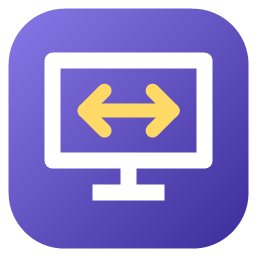
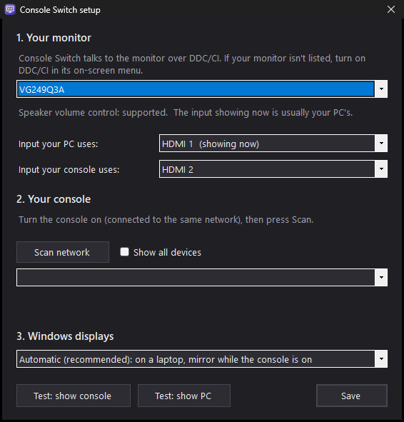

<p align="center"></p>

<h1 align="center">Console Switch</h1>

<p align="center"><b>One monitor, a PC and a console. Turn on the PlayStation and the monitor switches to it. Turn it off and you're back on your PC.</b></p>

<p align="center">
<a href="https://buymeacoffee.com/mehmeteminf"></a>
</p>

> **Beta.** I built this for my own laptop, an ASUS monitor and a PS5, and it has run my setup every day. The general version is new: if it misbehaves on your monitor or console, please [open an issue](../../issues) with your monitor model and the log (tray menu → Open log).

## The problem

You share one monitor between a laptop or PC and a console. Every time you want to play you dig for the monitor's input button, and when you're done it sits on "No signal" instead of going back to your PC. Many monitors' own auto-switch only works one way, and Windows can't tell when the console turns on.

## What it does

- **Switches to the console when it turns on.** Console Switch watches your local network for the console's exact MAC address.
- **Switches back the moment the console's picture goes away,** usually within 2 seconds, before the monitor's "No signal" box appears. It reads the monitor's own timing report over DDC/CI.
- **Monitor speaker volume from the tray,** even while the console is on screen. Left-click the tray icon for a volume slider.
- **"Fix console audio"** for the classic "console has no sound through the monitor" bug: it re-selects the input once, which makes the console re-read the monitor's audio formats. Speakers are dipped to 0 during the flip so they don't pop.
- **Laptop-aware:** while the console is on, Windows mirrors to the monitor so your windows and mouse stay on the laptop screen and volume control keeps working. When you're back, the monitor is extended and set as the main display again.
- **Survives IP changes.** If the console gets a new address it rescans the network, and if your PC ever gets the console's old IP it isn't fooled.
- Works with **PlayStation, Xbox and Nintendo Switch** (and any device with a fixed MAC), and with any monitor that supports **DDC/CI**.
- No account, no cloud, no telemetry. One small .exe.

<p align="center"></p>

## Install

1. Download `ConsoleSwitch.exe` from [Releases](../../releases) (or build it, see below).
2. Put it somewhere permanent, for example `C:\Tools\ConsoleSwitch\`, and run it.
3. Setup opens:
   - **Monitor:** pick yours. The input showing right now is usually your PC's; pick the one your console is plugged into.
   - **Console:** turn it on, press **Scan network**, pick it.
   - Press **Test: show console** and **Test: show PC** to check, then **Save**.
4. Tray menu → **Start with Windows**.

Windows SmartScreen may warn the first time because the .exe isn't code-signed. Choose **More info → Run anyway**, or build it yourself from the source.

## Requirements

- Windows 10 or 11 (uses the .NET Framework 4.x that ships with Windows)
- A monitor with **DDC/CI turned on** in its on-screen menu (most monitors since ~2015)
- The console on the same network as the PC (Wi-Fi or cable)

## Tips

- **PlayStation rest mode:** if "Stay connected to the internet" is on in rest mode, the console never leaves the network, so Console Switch can't tell it woke up. Switch to the PC is still instant when the picture goes away. Use the tray's "Show console now" when you wake it, or turn that rest-mode option off.
- **PS5 audio drops after boot:** PS5 → Settings → Sound → Audio Output → Audio Format: **Linear PCM** helps. If it still happens, use **Fix console audio**.
- **A fixed IP for the console** (a DHCP reservation in your router) makes detection instant.
- Shortcuts and Stream Deck buttons: `ConsoleSwitch.exe --console`, `--pc`, `--fix-audio`. `--probe` prints what it can see and changes nothing.

## How it works

| Part | How |
|---|---|
| Monitor control | DDC/CI through Windows' `dxva2` API: VCP `0x60` input, `0x62` speaker volume, timing report for "is there a picture" |
| Finding inputs | Parsed from the monitor's DDC/CI capabilities string |
| Console detection | Ping + ARP to match the exact MAC; full /24 rescan if it moved |
| Display layout | `SetDisplayConfig`: clone while the console is on, extend with the external monitor as primary after |

Settings and the log live in `%APPDATA%\ConsoleSwitch\`.

## Build

No SDK needed. The C# compiler that ships with Windows builds it:

```bat
build.bat
```

The output is `dist\ConsoleSwitch.exe`. `assets\make-icon.ps1` redraws the icon.

## Support

Console Switch is free and open source. If it saved you from hunting for the input button, you can [buy me a coffee](https://buymeacoffee.com/mehmeteminf) ☕. Bug reports with your monitor model are just as valuable.

## License

MIT
